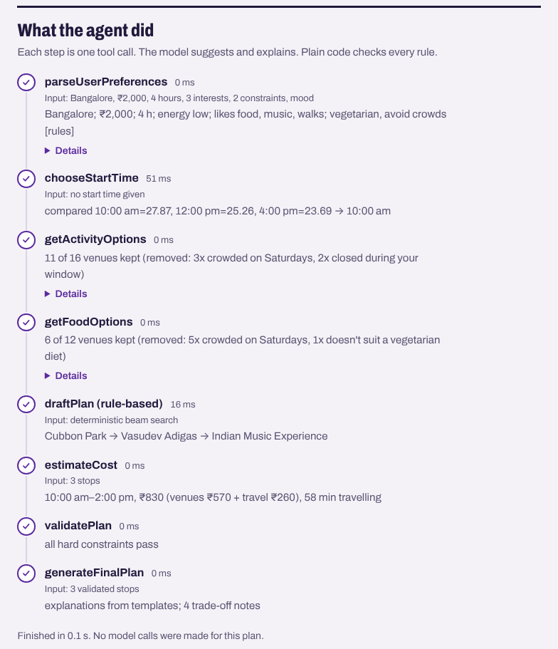

# Perfect Saturday Planner

**Live app:** [https://perfect-saturday-planner-1vp5.onrender.com](https://perfect-saturday-planner-1vp5.onrender.com) (On the free host the app sleeps when idle, so the first load can take about a minute. Open it once before you share it.)

An AI agent that plans a fun, realistic Saturday. Give it a city, budget, time, mood, interests and limits, as a form, as JSON or in plain words. It answers with a timed itinerary that has travel and cost worked out, a reason for every stop, the trade-offs it made, and a step-by-step trace of what it did.


*Shown in basic mode (no API key set when the screenshot was taken). With a key, the model drafts the plan and writes the explanations; the rules and numbers stay the same.*

## Try it

1.  Open the app, fill in the form (for example Bangalore, ₹2000, 4 hours, "tired but wants to do something fun") and click **Plan my Saturday**. The plan appears and the **What the agent did** panel fills in step by step.
2.  Leave the city empty. The agent asks one or two questions instead of guessing.
3.  Ask for something almost impossible (vegan, no crowds, ₹300, evening, Gurugram). It finds what little fits and says plainly what it could not do.
4.  Try a city with no curated data (Mumbai). It tries live OpenStreetMap data, and falls back to a labelled generic outline if that is unavailable.

You can also paste free text such as `Relaxed evening in Pune, around Rs 1500, vegan, no alcohol, 3 hours from 5 pm.`

## What the assignment asked for, and where it is

| Requirement | Where it is |
| --- | --- |
| Hosted app with a public URL | FastAPI backend serving a plain HTML/CSS/JS page. One-click Render deploy through `render.yaml`. |
| Understands preferences (JSON or free text) | `parseUserPreferences` accepts the form, the JSON in the brief (`POST /api/plan`) or free text. |
| At least 3 tools, not one giant prompt | 7 core tools and 5 situational ones. See [The tools](#the-tools). |
| Realistic, specific plan | Named venues with Saturday opening hours, prices, travel time and fares, crowd levels and meal times. |
| Explains why each part fits | A reason per stop, plus trade-offs, a backup option, assumptions and things to check. |
| Handles at least one failure case | Many. See [When things go wrong](#when-things-go-wrong). |
| Simple trace of what the agent did | The "What the agent did" panel, and the same events in the API response. |
| Bonus: real data | Cities without curated data use live OpenStreetMap lookups (`lookupLiveVenues`). |
| Bonus: streaming "thinking" trace | `POST /api/plan/stream` sends each step as it finishes. |
| Bonus: fallback when nothing matches | Soft limits are relaxed one at a time and reported. If that still fails, a generic outline. |
| Bonus: clarifying questions | One or two questions when the city is missing or ambiguous (`askClarifyingQuestions`). |
| Bonus: trade-offs | A "Trade-offs" block on every plan. |
| Bonus: avoid unrealistic suggestions | Every plan is scheduled and checked by code before it is shown. |

## How it works

The control flow is ordinary, deterministic Python. The model is used at three narrow points and never has the last word, because everything it proposes is re-scheduled and re-validated by code.

```
 your input (form / JSON / free text)
      |
      v
 parseUserPreferences  -- model reads messy text, rules check it -------------+
      |                                                                       |
      |  (no start time?) chooseStartTime: score a few starts, keep the best  |
      |  (city not curated?) lookupLiveVenues: OpenStreetMap, best effort     |
      v                                                                       |
 getActivityOptions + getFoodOptions   code filters hard limits, scores rest  |
      |                                                                       |
      v                                                                       |
 draftPlan (model suggests stops) --> estimateCost --> validatePlan           |
      ^                                                   |                   |
      +------------- repair, at most 2 times -------------+ problems?         |
      |                                                                       |
      v   still not clean, or no model                                        |
 draftPlan (rule-based beam search) --> estimateCost --> validatePlan         |
      |                                                                       |
      v   nothing valid                                                       |
 relaxConstraint: crowds, then energy/noise, then interests (never diet,      |
      budget, opening hours or time) ... then fallbackPlan (generic outline)  |
      |                                                                       |
      v                                                                       |
 generateFinalPlan  -- model phrases facts that code computed; a guard -------+
      |                rejects any rupee amount or time it did not get
      v
 plan + trade-offs + backup + trace
```

Why not let the model call tools freely? For a planner with hard limits (diet, budget, opening hours), the failure that matters is a confident plan that breaks a rule. Fixed orchestration with the model at the edges means a plan can never violate a hard limit, a model outage never breaks the app, behaviour is testable, and each plan costs a fraction of a cent. The cost is less autonomy: the model cannot choose to call tools in another order.

### The tools

| Tool | What it does | Uses the model? |
| --- | --- | --- |
| `parseUserPreferences` | Turns the form, JSON or free text into a typed preferences object. The model may add constraints it finds in the text but can never remove one you gave. Missing values get stated defaults. | Yes, then rules |
| `getActivityOptions` | Filters activities by diet, budget, opening hours, crowds, alcohol and indoor-only. Scores the rest by interests, energy and mood. Reports what it dropped and why. | No |
| `getFoodOptions` | The same for food, including meal timing and vegan/Jain handling. | No |
| `draftPlan` | Picks and orders stops. Either the model's draft or a deterministic beam search. | Yes, or no |
| `estimateCost` | Schedules the draft: start and end times, travel time and fare, waiting for opening, crowd at that hour, total spend. | No |
| `validatePlan` | Checks the schedule against every limit. Returns errors (must fix), major warnings (worth a repair) and minor notes. | No |
| `generateFinalPlan` | Writes the headline, a reason per stop and the trade-offs from facts that code computed. Falls back to templates. | Yes, then a guard |
| `chooseStartTime` | When no start time is given, plans a few candidate starts and keeps the best. | No |
| `lookupLiveVenues` | OpenStreetMap lookup for a city with no curated data: Overpass first, with Nominatim's category search as a backup. | No |
| `relaxConstraint` | Loosens one soft limit at a time and records it. | No |
| `fallbackPlan` | Generic outline for when no venue-specific plan is possible. | No |
| `askClarifyingQuestions` | Asks one or two questions when the city is missing or ambiguous. | No |

### Hard limits and soft preferences

-   **Hard limits** remove a venue before planning and reject any plan that breaks them: diet, budget (venues plus autos and cabs), your time window, opening hours (waits of 30 minutes or less), "no alcohol", "indoor only" and, if you asked to avoid crowds, places that are busy when you would be there.
-   **Soft preferences** only change a venue's score or raise a warning: your interests, energy and noise fit for your mood, how much time goes on travel, the number of stops, how much of the window is used, and long gaps between meals.
-   **If nothing valid exists**, the agent relaxes in this order: avoid crowds, then energy and noise, then interests. It reports each one it relaxed. Diet, budget, time window and opening hours are never relaxed.

Diet handling is deliberately careful. Vegetarian excludes meat-focused places. Vegan accepts places marked vegan-friendly, or pure-veg places that are not built around dairy, with an "ask for vegan preparation" caution. If a place's diet is unknown, vegetarian is allowed with a "confirm they have vegetarian options" caution, and vegan or Jain is rejected.

### What keeps the plan realistic

-   Travel uses area centroids and straight-line distance times 1.35. Up to 1.2 km is a walk; beyond that an auto or cab at the city's typical Saturday speed. The fare is `max(60, 45 + 15 × km)`.
-   Each venue has Saturday opening windows. Arriving early means waiting, and the plan refuses waits over 30 minutes.
-   Crowd level is a baseline plus a bump in the venue's peak hours, evaluated at the time you would be there.
-   Meals are placed in meal windows. Hops over 45 minutes are warned about and over 75 minutes rejected.
-   Spare time becomes longer stays, up to each venue's sensible maximum, rather than filler stops.
-   The model sees only venues that survived the filters, so it cannot suggest a closed, too-expensive or off-diet place. Venue ids it returns are re-checked, and all times and costs are recomputed by code.

### When things go wrong

| Situation | What the agent does |
| --- | --- |
| City missing or ambiguous ("Pune or Bangalore") | Asks one or two questions instead of picking. |
| City with no curated data | Tries live OpenStreetMap data from Overpass and, if that is slow or down, from Nominatim's category search. Only if both fail does it return a clearly labelled generic outline. |
| Nothing fits (for example ₹0 and "avoid crowds") | Relaxes soft limits in order and lists what it relaxed. Never relaxes diet, budget, hours or time. If still nothing, says so plainly. |
| Model times out, errors or returns bad JSON | Retries once with the error fed back, then uses the rule-based step. A hard failure (bad key, quota, outage) turns the model off for that request, and a circuit breaker pauses calls for 45 seconds after repeated failures. |
| Model proposes a plan that breaks a rule | The validator rejects it and the agent asks for a repair (at most 2), then falls back to the rule-based draft. |
| Model invents a rupee amount or a time | The guard rejects the sentence and the template is used. |
| No API key | Basic mode: the same agent with rules instead of the model, and the page says so. |
| Strange input (HTML, emoji, absurd numbers, thirteen interests) | Text is sanitised before it is echoed, numbers are validated, long lists are truncated. Bad values return a plain 422 message. |
| Unexpected exception anywhere | The whole agent is wrapped; the user gets the generic outline, and a `recover` step appears in the trace. |
| Abuse or overload | 20 requests per minute per client, a daily cap on model-assisted plans, 16 KB request bodies, 8 concurrent plans. Friendly 429 and 503 messages. |

### The trace

Every tool call becomes an event with its name, input, a one-line result, status and duration. The page shows them as they stream in; the API returns them in `trace`. Click **Details** on a step to see what it dropped and why, for example `1 of 9 venues kept (removed: 4x crowded on Saturdays, 2x closed during your window, 2x over your budget)`.



## Data

Bangalore (28 venues), Pune (24) and Gurugram (14) are curated JSON files in `app/data/`. Each venue has an area, typical cost and duration, Saturday opening windows, crowd level and peak hours, noise, energy, diet details and a "verify" note. **This is sample data written from general knowledge, not a live feed.** Prices and hours are approximate, Gurugram is the thinnest, and every plan says to check hours and prices before going. Budgets are for one person and cover venues plus getting around.

Other cities use OpenStreetMap. The app asks Overpass for nearby venues in one request. Overpass is a free public service that is often slow or down, so if it has not answered after 3 seconds (or fails sooner) the app also runs Nominatim's category search (park, museum, cafe, restaurant and so on) around the city centre, one request per second as Nominatim's usage policy requires, and uses whichever source delivers first. A city that goes through the backup takes about 15 seconds the first time; results are cached for 24 hours. OpenStreetMap has no prices and patchy opening hours, so those plans say what is guessed.

## API

```bash
curl -s localhost:8000/api/plan -H 'content-type: application/json' -d '{
  "city": "Bangalore", "budget": 2000, "available_time": "4 hours",
  "mood": "tired but wants to do something fun",
  "interests": ["food", "music", "walks"],
  "constraints": ["vegetarian", "avoid crowded places"]
}'
```

| Endpoint | Purpose |
| --- | --- |
| `POST /api/plan` | Returns `{"result": ..., "trace": [...]}`. Fields: `city`, `budget`, `available_time`, `mood`, `interests`, `constraints`, `start_time`, `free_text`. All optional. |
| `POST /api/plan/stream` | The same, as newline-delimited JSON: `step` events (running, then finished), then `result`. A `ping` every 8 seconds keeps proxies from closing a quiet stream. |
| `GET /api/health` | Whether the model is enabled, which model, and the supported cities. |
| `GET /api/examples`, `GET /healthz`, `GET /api/openapi.json` | The example inputs, a liveness check and the schema. |

`result.status` is `ok`, `fallback` (generic outline) or `needs_info` (questions to answer). `result.mode` is `ai` when the model contributed and `basic` otherwise.

## Run locally

Python 3.11, 3.12 or 3.13.

```bash
python3 -m venv .venv && source .venv/bin/activate     # Windows: .venv\Scripts\activate
pip install -r requirements.txt
cp .env.example .env                                   # Windows: copy .env.example .env
# optional: put your key in .env as OPENAI_API_KEY=...  (without it the app runs in basic mode)
uvicorn app.main:app --reload
```

Open [http://localhost:8000](http://localhost:8000). To check the model path end to end with your key, run `python scripts/smoke_llm.py`. It sends a tiny request and then the assignment's example, and exits 0 only if the plan was made in `ai` mode. It never prints the key.

### Configuration

Set these as environment variables (or in `.env`). Only `OPENAI_API_KEY` matters for a normal deploy.

| Variable | Default | Meaning |
| --- | --- | --- |
| `OPENAI_API_KEY` | empty | Enables AI mode. Never commit it. |
| `OPENAI_MODEL` | `gpt-6-luna` | Any chat model your account can use. |
| `OPENAI_BASE_URL` | empty | Any OpenAI-compatible endpoint. |
| `OPENAI_API_MODE` | `chat` | `chat` for Chat Completions or `responses` for the Responses API. |
| `OPENAI_REASONING_EFFORT` | `auto` | Small per-task effort for reasoning models only. `off` never sends it. |
| `LLM_TIMEOUT_S`, `LLM_MAX_OUTPUT_TOKENS` | `25`, `2500` | Limits per model call. |
| `MAX_REPAIRS` | `2` | Repair attempts before the rule-based draft. |
| `REQUEST_DEADLINE_S` | `75` | After this, stop calling the model and finish in basic mode. |
| `RATE_LIMIT_PER_MIN` | `20` | Per client address. |
| `DAILY_LLM_RUN_CAP` | `400` | Model-assisted plans per UTC day. Beyond it the app keeps working in basic mode. |
| `ENABLE_LIVE_DATA` | `true` | OpenStreetMap lookup for cities without curated data. |
| `CONTACT_EMAIL` | empty | Put an address you read; OpenStreetMap's usage policy asks for one. |
| `LOG_LEVEL` | `INFO` | Logging verbosity. The app logs one summary line per plan (status, city, timing, token counts) and never the API key. |

## Deploy (Render, free)

1.  Push this folder to a GitHub repository.
2.  In Render choose **New + > Blueprint** and pick the repository. It reads `render.yaml` (Python web service, free plan, health check at `/healthz`).
3.  When prompted, paste `OPENAI_API_KEY` in the Render dashboard. The key lives only there, never in the repository.
4.  When the deploy is live, open `/api/health`. It should show `"ai_enabled": true` and the model name. Then open the home page and plan a Saturday in Bangalore; the note under the plan headline should read "Planned with an AI model (...) and checked by code."
5.  Put the URL at the top of this README.

Python 3.12 is chosen by `.python-version`. The free plan sleeps after about 15 minutes idle, so open the URL shortly before sharing it. The `Procfile` and `Dockerfile` work on other hosts that run a Python web process or a container (Railway, Fly.io, Cloud Run and similar); they only need `PORT` and the same environment variables.

## Tests

```bash
pip install -r requirements-dev.txt
pytest -q                          # about 580 tests, around 15 seconds, no network or API key needed
SWEEP_N=2000 pytest tests/test_properties.py   # bigger randomised sweep
python scripts/scenarios.py        # prints the rule-based (no model) plans for a spread of realistic inputs
python scripts/nasty_inputs.py     # hostile and odd inputs, none may crash
```

What they cover: parsing and unit logic; the full pipeline with a scripted model (good drafts, rule-breaking drafts, nonsense, outages); invariants checked over hundreds of random inputs (every plan within budget, inside the window, open when visited, on diet); the HTTP API including streaming, rate limits and body caps; the OpenStreetMap parsing against recorded responses; and the OpenAI client against a mocked HTTP layer. Nothing in the suite calls a real model, so run `scripts/smoke_llm.py` with a key to check that.

## Cost

With the default model, listed at about $0.10 per million input tokens and $0.50 per million output tokens ([OpenAI model page](https://developers.openai.com/docs/models/gpt-6-luna)), a typical plan sends roughly 3,700 input tokens across three calls. That is a few tenths of a cent. The worst case, with two repair drafts, is still under a cent. `DAILY_LLM_RUN_CAP` bounds the daily spend. Check the pricing page for your account before relying on these figures.

## Project layout

```
app/
  main.py        FastAPI app: plan and stream endpoints, rate limits, security headers
  agent.py       the orchestrator: control flow, repair loop, fallbacks, trace
  tools/         preferences, options, planner, costing, validate, finalize, osm
  llm.py         OpenAI wrapper: validated JSON replies, retries, circuit breaker
  prompts.py     the prompts for the three model steps
  schemas.py     Pydantic models for input, preferences, plan and trace
  rules.py cities.py geo.py util.py trace.py config.py examples.py
  data/          curated venues for Bangalore, Pune and Gurugram
  static/        the web page: plain HTML, CSS and JS, no build step
tests/           unit, pipeline, property, API, OpenStreetMap and packaging tests
scripts/         scenarios, nasty inputs, live model smoke test
docs/            screenshots used here
```

## Decisions and trade-offs

-   **Code owns the rules, the model owns the words and the messy parts.** Reading free text, proposing a creative ordering and phrasing the explanation are things a model does well. Budgets, opening hours and diets are things code must get right every time.
-   **Basic mode always works.** The same agent runs without a key. A quota problem, an outage or a bad reply degrades quality a little rather than breaking the page.
-   **Honest data over impressive data.** Three small curated cities with plain "verify before you go" notes, plus live OpenStreetMap for the rest, instead of scraped or invented listings.
-   **Stateless and small.** No database, no accounts, in-memory rate limiting. It suits one small instance. For several instances you would move the limiter to shared storage.
-   **No build step for the UI.** One HTML file, one stylesheet, one script, with a strict Content-Security-Policy.

## Limitations

-   Venue data is approximate sample data for three cities. Gurugram is thin, so some requests there end in a short plan or an honest "nothing fits".
-   Costs are for one person and are estimates. There is no live traffic, weather, ticket availability or opening-hours check.
-   The rate limiter lives in memory and identifies clients by the last `X-Forwarded-For` address, so behind a shared proxy several visitors can share a bucket, and a restart resets it.
-   OpenStreetMap lookups depend on free public servers, can take about 15 seconds the first time for a new city, and carry little price information. The venues come from map tags, so quality varies by city.
-   English only. The agent plans one Saturday, not a multi-day trip.

## How I used AI tools

I built this with Claude as the coding assistant. We brainstormed the approach first, and then it wrote the code, the tests and the docs in one working session. I chose the stack (Python and FastAPI, OpenAI's cheapest current model, Pune and Gurugram as the extra cities) and the main design call: deterministic orchestration where code enforces the rules and the model reads messy input, drafts, and phrases the result. The decisions above are the ones I can walk through.