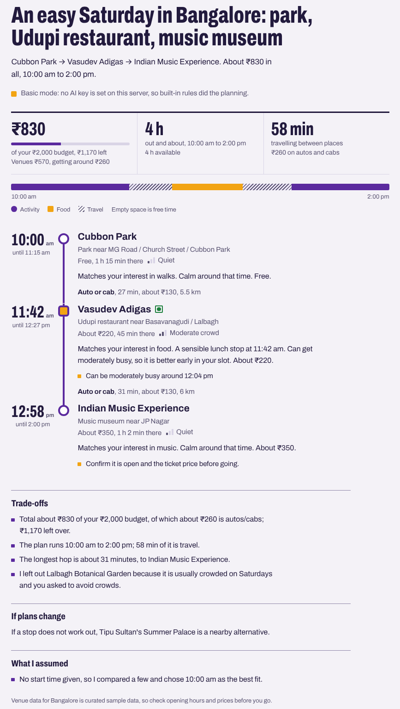

# Perfect Saturday Planner

An agent that plans your Saturday. You give it a city, budget, time, mood, interests and limits (as a form, as JSON, or as a sentence) and it gives back a timed plan with places, travel, cost and a reason for every stop. A panel next to the plan shows what the agent did, step by step.

**Live app:** [https://perfect-saturday-planner-1vp5.onrender.com](https://perfect-saturday-planner-1vp5.onrender.com)

It runs on a free plan and sleeps when nobody is using it, so the first load can take about a minute.



*This one is in basic mode (no API key was set when I took the screenshot). With a key, the model drafts the plan and writes the wording. The rules and numbers stay the same.*

## Try it

Fill in the form, type a sentence in the box at the bottom, or paste the JSON from the brief. Some things to try:

- The example from the brief: Bangalore, ₹2000, 4 hours, "tired but wants to do something fun", food, music and walks, vegetarian, avoid crowds.
- Fill in only a budget. It asks which city instead of guessing.
- Gurugram, ₹300, vegan, avoid crowds, evening. It finds what little fits and tells you what it left out.
- A city I have no data for, like Mysore. It looks up places on OpenStreetMap, which takes about 15 seconds the first time.

## How it works

Plain code runs the flow. The model is used in three places only: reading messy text, drafting the plan, and writing the explanations. Whatever it suggests is rescheduled and checked by code (budget, opening hours, diet, time window), so a plan can't break a limit you set. If the model fails, or there is no API key, the same agent runs on rules. I call that basic mode and the page says when it is on.

I chose this over letting the model call tools freely because for a planner the worst failure is a confident plan that breaks a rule. The price is less autonomy, which I was fine with.

### The tools

| Tool | What it does |
| --- | --- |
| `parseUserPreferences` | Turns the form, JSON or text into preferences. The model can add details it finds in the text but can't remove a limit you gave. |
| `getActivityOptions` | Filters activities by diet, budget, opening hours, crowds, alcohol and indoor-only, then scores the rest. |
| `getFoodOptions` | The same for food, with meal times and vegan or Jain handling. |
| `draftPlan` | Picks and orders the stops. Uses the model's draft, or a rule-based search without a model. |
| `estimateCost` | Schedules the stops: times, travel and fares, waiting for places to open, total cost. |
| `validatePlan` | Checks the schedule against every limit. |
| `generateFinalPlan` | Writes the headline, the reason for each stop and the trade-offs, using numbers the code already worked out. Uses templates if the model fails. |
| `chooseStartTime` | If you gave no start time, tries a few and keeps the best. |
| `lookupLiveVenues` | OpenStreetMap lookup for a city with no data. Overpass first, Nominatim as a backup. |
| `relaxConstraint` | Loosens one soft limit at a time (crowds, then energy and noise, then interests) and says so. |
| `fallbackPlan` | A generic outline for when no real plan is possible. |
| `askClarifyingQuestions` | Asks one or two questions when the city is missing or unclear. |

### When things go wrong

- **No key, or the model fails or times out:** basic mode. If the model writes a rupee amount or a time the code didn't give it, that sentence is thrown out.
- **City missing, or two cities:** it asks.
- **No data for the city and the map servers don't answer:** a generic outline, clearly labelled.
- **Nothing fits:** it relaxes soft limits in order and lists what it relaxed. It never relaxes diet, budget, opening hours or your time window.
- **Strange input (HTML, emoji, huge numbers):** cleaned up or rejected with a plain message.
- **Too much traffic:** 20 requests a minute per visitor, 16 KB request bodies, a daily cap on model runs.

## Data

Bangalore (28 venues), Pune (24) and Gurugram (14) are JSON files in `app/data/`. I wrote them from general knowledge, so prices and hours are approximate, and every plan says to check before you go.

For other cities the app asks Overpass for parks, museums, historic sites, cafes, restaurants, markets and malls near the city centre. Overpass is a free public server that is often slow or down, so if it hasn't answered after 3 seconds the app also runs Nominatim's category search (park, museum, cafe and so on) at one request per second, and uses whichever answers first. Results are cached for a day. OpenStreetMap has no prices, so for those cities the prices are guesses. It has no crowd levels either: every place counts as moderately busy, except markets and malls, which I treat as busy. So "avoid crowds" really only filters those two there. Needs like wheelchair access are listed under "check before you go", not checked against the map.

## API

```bash
curl -s localhost:8000/api/plan -H 'content-type: application/json' -d '{
  "city": "Bangalore", "budget": 2000, "available_time": "4 hours",
  "mood": "tired but wants to do something fun",
  "interests": ["food", "music", "walks"],
  "constraints": ["vegetarian", "avoid crowded places"]
}'
```

| Endpoint | What it does |
| --- | --- |
| `POST /api/plan` | Returns `{"result": ..., "trace": [...]}`. Fields: `city`, `budget`, `available_time`, `mood`, `interests`, `constraints`, `start_time`, `free_text`. All optional. |
| `POST /api/plan/stream` | The same, as newline-delimited JSON: a `step` event as each tool starts and finishes, then the `result`. |
| `GET /api/health` | Whether the model is on, which model, and the cities. |
| `GET /api/examples`, `GET /healthz`, `GET /api/openapi.json` | Example inputs, a liveness check and the schema. |

`result.status` is `ok`, `fallback` (generic outline) or `needs_info` (it has questions). `result.mode` is `ai` if the model helped and `basic` if not.

## Run locally

You need Python 3.11 or newer.

```bash
python -m venv .venv
source .venv/bin/activate          # Windows: .venv\Scripts\activate
pip install -r requirements.txt
cp .env.example .env               # Windows: copy .env.example .env
uvicorn app.main:app --reload
```

Open [http://localhost:8000](http://localhost:8000). Without an API key in `.env` it runs in basic mode. To check the model path with your key, run `python scripts/smoke_llm.py`. It never prints the key.

## Configuration

Environment variables, or put them in `.env`. Only `OPENAI_API_KEY` matters for a normal deploy.

| Variable | Default | What it does |
| --- | --- | --- |
| `OPENAI_API_KEY` | empty | Turns on AI mode. Never commit it. |
| `OPENAI_MODEL` | `gpt-6-luna` | Any chat model your account can use. |
| `OPENAI_BASE_URL` | empty | Any OpenAI-compatible endpoint. |
| `OPENAI_API_MODE` | `chat` | `chat` or `responses`. |
| `OPENAI_REASONING_EFFORT` | `auto` | Only sent to reasoning models. `off` never sends it. |
| `LLM_TIMEOUT_S`, `LLM_MAX_OUTPUT_TOKENS` | `25`, `2500` | Limits for each model call. |
| `MAX_REPAIRS` | `2` | How many times the model may fix a rejected plan. |
| `REQUEST_DEADLINE_S` | `75` | After this many seconds the model is skipped for the rest of the request. |
| `RATE_LIMIT_PER_MIN` | `20` | Per client address. |
| `DAILY_LLM_RUN_CAP` | `400` | Model runs per UTC day. After that the app keeps working in basic mode. |
| `ENABLE_LIVE_DATA` | `true` | OpenStreetMap lookup for cities without data. |
| `CONTACT_EMAIL` | empty | An address for OpenStreetMap's usage policy. |
| `LOG_LEVEL` | `INFO` | The app logs one line per plan and never the key. |

## Deploy (Render, free)

1. Push the repo to GitHub.
2. In Render choose **New + > Blueprint** and pick the repo. It reads `render.yaml`.
3. Paste `OPENAI_API_KEY` when asked. It lives only in Render, never in the repo.
4. When it's live, open `/api/health`. It should say `"ai_enabled": true`.

The Python version comes from `.python-version`. The free plan sleeps after about 15 minutes idle. The `Procfile` and `Dockerfile` should work on other hosts, they just need `PORT` and the same variables.

## Tests

```bash
pip install -r requirements-dev.txt
pytest -q
```

About 600 tests, a minute or two, no network or API key needed. They cover parsing, the whole pipeline with a scripted fake model (good replies, bad replies, outages), random inputs checked against budget, time window, opening hours and diet, the API, and the OpenStreetMap parsing. Nothing in the suite calls a real model, which is what `scripts/smoke_llm.py` is for. `python scripts/scenarios.py` and `python scripts/nasty_inputs.py` print plans for a spread of normal and awkward inputs.


## Limits

- The venue data for the three cities is sample data, and Gurugram is thin.
- Costs are estimates for one person, in rupees. For a city outside India treat them as a rough guide only.
- OpenStreetMap lookups depend on free public servers and take about 15 seconds the first time for a city. Map tags don't say whether a place is open to the public, so now and then a suggestion is wrong.
- No live traffic, weather or ticket availability.
- The rate limiter is in memory, so this suits one small instance.
- English only, one Saturday, one person.

## How I used AI tools

I used Claude as a coding assistant. We talked through the approach first, then it wrote the code, the tests and the docs, and it helped with the deploy. I picked the stack (Python and FastAPI, OpenAI's cheapest current model, Pune and Gurugram as the extra cities) and the main design: code enforces the rules, and the model only reads messy input and writes the words.
